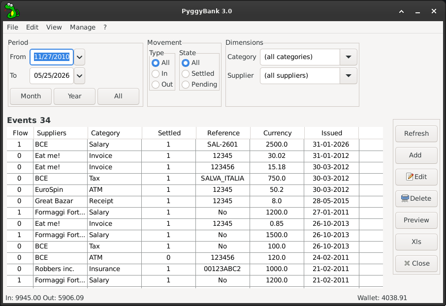

# PyggyBank 3.0

A small desktop "piggy bank" / personal cash-flow manager: record money **in**
and **out**, tag each entry with a supplier and a category, filter the ledger,
and print it to PDF or export it to Excel.

Built with **Python 3 + wxPython 4 (Phoenix)**, **SQLite**, **ReportLab** and
**openpyxl**.



> Version 3.0 is a full port of the original 2017 codebase (Python 2 + wxPython
> 2.8 Classic) **and** an architectural refactor to a clean MVP design. See the
> changelog at the bottom.

## Features

* **Ledger** of transactions in a fast virtual `ListCtrl`, click a header to sort.
* **Filters**, grouped by family in a dedicated bar:
  * **Period** — a *From / To* range with one-click presets (Month, Year, All).
  * **Movement** — Type (All / In / Out) and State (All / Settled / Pending).
  * **Dimensions** — independent Category and Supplier combos (combinable).
  * *Show disabled* (View menu) reveals soft-deleted rows; they are hidden by default.
* **Running totals** (In / Out / Wallet) in the status bar, rounded to cents.
* **CRUD** on transactions; manage the Category / Supplier lookup tables.
* **PDF report** (ReportLab) and **Excel export** (openpyxl).
* **Database maintenance** (File ▸ Database): Backup (online copy), Compact
  (VACUUM), and Clear transactions (wipes the ledger and resets the id counter).

## Architecture (Model–View–Presenter)

The GUI never touches SQL or the database: everything goes through a domain
layer. Data access is fully decoupled from presentation.

```
 View (wxPython, passive)        Presenter (pure Python)      Domain / data
 ─────────────────────────       ───────────────────────      ─────────────────────
 MainFrame  ── intent ──►  MainPresenter ──►  Controller ──►  DBMS ──►  SQLite
   (implements MainView)     (filters, totals,   (get_flows,    (connection,
   virtual ListCtrl          sorting; no wx)     save_event,    read/write,
   FilterPanel                                   lookups…)      build_sql)
 dialogs / lookup editor   ◄──── data by name (dicts) ─────►    SQL from queries.json
 XlsExporter, GeneratePDF
```

| Module | Responsibility |
|--------|----------------|
| `pyggy.py` | launcher + dependency injection (`Engine → Controller → MainPresenter → MainFrame`) |
| `dbms.py` | `DBMS`: SQLite connection, `read`/`write`, `build_sql`, SQL-identifier validation, backup/vacuum, **dict rows** |
| `engine.py` | `Engine(DBMS)` singleton; loads `queries.json`; UI services (icon, font, calendar, dialogs) + `log.txt` logging |
| `controller.py` | domain layer: `get_flows`, `save_event`, lookup CRUD, name resolution, DB maintenance |
| `models.py` | `FlowFilter` value object (movement, dimensions, date range) |
| `presenters.py` | `MainPresenter` (pure, testable) + `MainView` protocol |
| `exporters.py` | `XlsExporter` (openpyxl, pure) |
| `reports/rpt_flows.py` | `GeneratePDF` + `ReportHeader` (ReportLab, no app reference) |
| `frames/main.py` | `MainFrame` — passive view, virtual `ListCtrl`, menus |
| `frames/filter_panel.py` | `FilterPanel` — the grouped filter bar; builds a `FlowFilter` |
| `frames/update_data.py` | add / edit an event |
| `frames/lookup_manager.py` | list & manage categories / suppliers |
| `frames/lookup_editor.py` | add / edit one category or supplier |
| `queries.json` | the SQL statements (data, not code) |
| `pyggy.db` | sample SQLite database |

## Requirements

* Python 3.8+
* wxPython >= 4.2 (Phoenix)
* reportlab >= 4.0
* openpyxl >= 3.0
* SQLite (bundled with Python)

## Run

```sh
# if wxPython is installed system-wide, let the venv see it:
python3 -m venv --system-site-packages .venv
.venv/bin/pip install -r requirements.txt
.venv/bin/python pyggy.py
```

(If wxPython is *not* installed system-wide, add `wxPython` to the pip install
and drop `--system-site-packages`.)

The window follows your desktop's GTK theme (light or dark) — that is intended.

## Development & tests

```sh
.venv/bin/pip install -r requirements-dev.txt
.venv/bin/python -m pytest
```

The presenter, exporter and report tests run with **no wxPython and no
database** (the payoff of the MVP split); the controller/DBMS tests run against
a throwaway SQLite copy.

## Changelog

### 3.0
* Ported Python 2 → 3 and wxPython 2.8 (Classic) → 4.2 (Phoenix).
* `xlwt` → `openpyxl`; ReportLab 2 → 4.
* Refactored to MVP: passive `MainFrame` over a `MainPresenter`, with a
  `Controller`/`DBMS` data layer. The GUI no longer issues SQL.
* Virtual `ListCtrl`; dict-based rows; SQL moved to `queries.json`.
* Export (XLS) and the PDF report extracted into standalone, app-independent
  services.
* **Filters redesigned** into a `FilterPanel` grouped by Period / Movement /
  Dimensions: a From/To date range with Month/Year/All presets, explicit
  In/Out and Settled/Pending choices, and independent Category/Supplier combos
  (replacing the old polymorphic combo and tri-state checkboxes).
* **Menus restructured** (File / Edit / View / Manage / ?) mirroring the action
  buttons, with a File ▸ Database submenu for backup / compact / clear.
* Running totals rounded to cents.
* Type hints, docstrings, `on_log` → `log.txt`, and a pytest suite.

### 2.3 (historical, Python 2 / wxPython 2.8)
Architecture centred on `wx.GetApp()`; ran on Debian Squeeze. Original launch:
`python pyggy.py` with Python ≤ 2.6, wxPython 2.8.10.1, ReportLab 2.4.

## Author & license

Giuseppe Costanzi (1966bc) — <giuseppe.costanzi@gmail.com>
GNU GPL v3 / wxWindows License. See `LICENSE` and `copying`.
